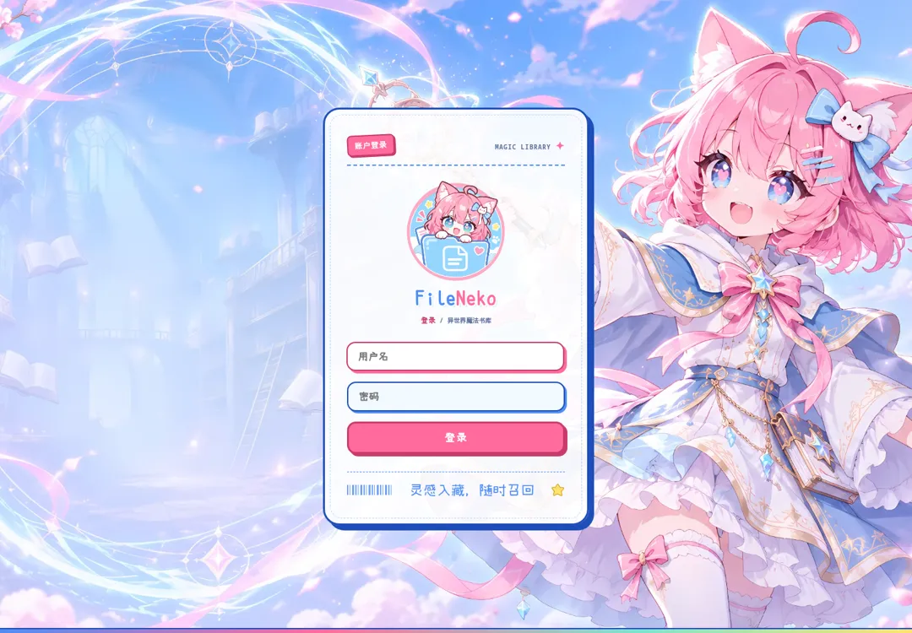
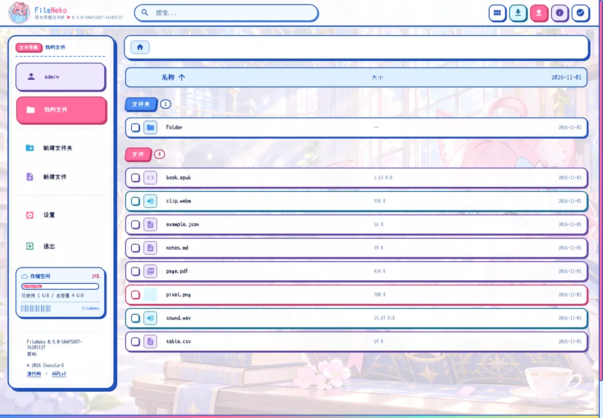

# 壁纸与小赖字体个性化示例

这个示例可直接作为 FileNeko 的品牌资源目录使用，无需重新编译。它使用独立的登录壁纸、文件管理壁纸、自定义 Logo 和本地小赖等宽字体，保留内置蓝粉配色与布局。

## 效果预览





预览使用随附素材与 CI 产物生成；`previews/` 只供文档展示，无需部署。

## 目录

```text
personalized-examples/
  README.md
  custom.css
  img/
    login.webp                 # 登录页壁纸
    background.webp            # 文件管理及其他页面壁纸
    logo.svg                   # 登录页和页头自动替换的 Logo
    logo.png                   # 备用位图，默认不加载
    fonts/
      XiaolaiMono-Regular.woff2 # 小赖等宽字体
```

运行时只需要 `custom.css` 和完整的 `img/` 目录。README 不参与页面加载。素材沿用提供的文件；图片与字体的作者、来源及再分发授权请由素材提供者补充确认，不应把项目代码许可证视为这些素材的授权声明。

## 配置

1. 将本目录复制到服务器，例如 `/srv/fileneko/branding`，保留目录结构，并确保运行 FileNeko 的用户可以读取这些文件。
2. 以管理员登录，在 **设置 → 全局设置 → 品牌 → 品牌资源目录路径** 填写 `/srv/fileneko/branding`。这是服务器上的绝对路径，不是浏览器 URL，也不是 `img/` 子目录。
3. 保存并刷新页面。实例名称可以另行设置；侧栏底部仍显示 FileNeko。默认的标签页图标不变，本示例只替换登录页与页头 Logo。

也可以先停止服务，再对服务实际使用的数据库执行：

```sh
fileneko -d /实际路径/filebrowser.db config set \
  --branding.files /srv/fileneko/branding
```

随后使用原来的参数启动服务。不要在服务运行时同时用 CLI 写入同一个数据库。容器部署时，填写容器内的挂载路径。

## 样式说明

- 登录页读取 `img/login.webp`；文件管理及设置、分享等页面读取 `img/background.webp`。文件管理背景叠加 70% 不透明度的白色遮罩（背景透出 30%），降低壁纸对 UI 的干扰；共用该背景的设置、分享页也采用此效果，登录壁纸保持原样。可在 `.fn-page-background` 的 `linear-gradient()` 中调整两个 `70%` 数值。壁纸居中铺满，屏幕比例不同时会裁切边缘，可在 CSS 中调整 `background-position`。
- 页头、侧栏、登录卡片、文件卡片、设置卡片、弹窗、加载及状态卡片使用 `rgb(255 255 255 / 90%)`：白色不透明度为 90%，背景透出 10%。文件卡片内层设为透明，避免叠加白色后降低透出效果。
- 仅改变背景色的透明度，不设置整体 `opacity`；文字、图标、缩略图和按钮保持清晰。输入框、按钮、彩色标题条和存储空间等装饰区域仍保留内置配色。
- `@font-face` 从本地加载字体，设置 UI、标题、等宽信息和签名字体变量，不覆盖 Material Icons。字体约 11.3 MiB，首次加载可能稍慢；`font-display: swap` 允许先显示回落字体。
- CSS 中的素材使用相对路径，支持根路径和 `/library` 等子路径部署。不要将这些相对图片 URL 移进由内置样式读取的变量中。

详细接口见 [主题接口 v1](../theme-api.md)，其他品牌选项见 [自定义外观](../customization.md)。

## 检查与排障

修改后强制刷新，或在浏览器开发工具中禁用缓存。品牌资源可能缓存一天；其他用户也需要刷新页面。

在网络面板检查 `custom.css`、两个 WebP、`img/logo.svg` 和字体请求是否成功；子路径部署时，请求应保留部署前缀。若返回 HTML 或 404，请检查品牌目录路径、文件名大小写和服务读取权限。只出现字体回落时，检查字体请求和浏览器字体加载错误。

恢复默认外观时，将品牌资源目录路径清空并保存、刷新即可；无需删除素材。

## 验证记录

使用 `temp/linux-amd64-fileneko/fileneko`（`36101f27`）与 Chromium 133，在临时数据库和测试文件目录中验证，未使用现有服务数据库：

- 根路径与 `/library` 子路径均能加载主题、背景、Logo 和字体。
- 浏览器确认标题实际使用自定义的 XiaolaiMono 字体。
- 登录卡片、页头与文件列表卡片计算背景色为 `rgba(255, 255, 255, 0.9)`。
- 桌面 1440 × 1000、手机 390 × 844 / 390 × 667 登录页，以及桌面和手机文件页完成截图检查。

预览基于亮色模式；其他屏幕比例可按实际壁纸构图调整背景位置。
